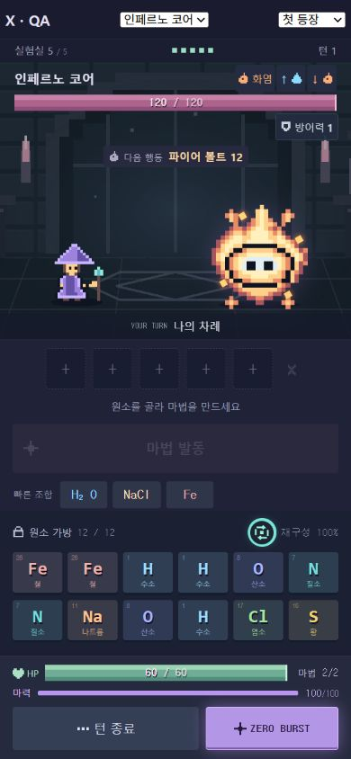
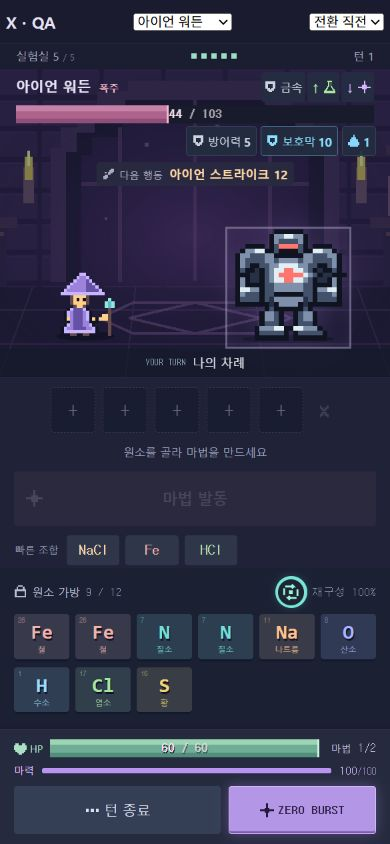
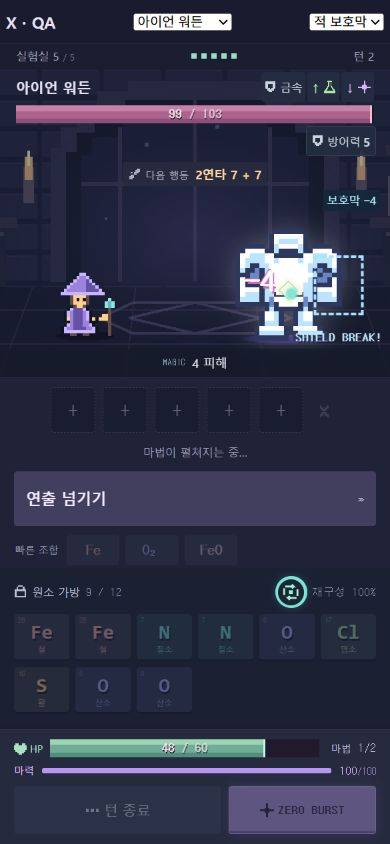

# CHEMAGE PHASE 10 검증 보고서

로컬 PHASE 9 소스 기준, 2026-10-28(KST). **미배포**. 이전 배포 체크아웃 `releases/phase8`은 수정하지 않았으며 최종 Git 상태도 깨끗합니다.

## 구현

- 5전투와 기존 일반 적·정예를 유지하고 마지막 보스를 골렘/인페르노/워든 중 기본 1/3 확률로 선택합니다. 모험 생성 시 route에 확정하고 보상·전투 중 다시 뽑지 않습니다.
- 일반 적 경로 추첨에서 이미 소비한 첫 난수로 별도 보스 스트림을 파생합니다. 원소·보상 RNG에서 추가 난수를 소비하지 않습니다. 동일 시드 재현, 6,000시드 분포, 기존 RNG 소비 횟수를 검사했습니다. 테스트의 boss/bossRng 주입은 일반 UI에 노출하지 않습니다.
- 인페르노: 화염 투사체, 화염 2연타, 오버히트 충전과 폭발. 절반 체력에서 OVERDRIVE와 강화된 불꽃 외형.
- 워든: 단일 타격, 더블 해머, 스틸 배리어, 헤비 프레스. 절반 체력에서 FORTRESS MODE, 붉은 코어와 보호막 +10을 한 번 획득.
- 워든의 남은 적 보호막은 유지합니다. 일반 배리어는 현재 값과 목표 값(10/12)의 최댓값으로 갱신하며 합산하지 않습니다. 다음 배리어 선택 시 10 이상 남아 있으면 기본 공격으로 예고합니다. 페이즈 최초 +10을 포함한 구조상 최대는22입니다. HP 회복은 없습니다.
- 신규 보스는 피해 적용 후 체력이 절반 이하가 되면 전환합니다. **이미 예고한 이번 행동과 피해량은 유지**하고 다음 행동을 새로 예고할 때 강화 수치를 사용합니다. 충전 중 전환하면 강화된 다음 강공격을 예고하며 취소하지 않습니다.
- 골렘 HP120·방어력0·기존 공격 배열을 유지했습니다. 충전 행동 종료와 페이즈 전환이 겹쳐 강공격이 사라지던 경우만 보완했습니다. 이 경우 예고했던24 피해를 먼저 실행하고 기존 2페이즈로 진입합니다.
- 전용 픽셀 그리드/SVG, 화염·해머 이펙트, 2페이즈 외형과 보스 공통 처치 연출. 기존 1.0/1.5배속과 움직임 줄이기 적용.
- 진입 안내에 실제 이름·속성·소개를 표시하고, 신규 보스 상세 전략은 기존 가이드의 seen/disabled 및 건너뛰기를 재사용합니다. 도움말에서 다시 읽을 수 있습니다. 승리 화면도 실제 보스 이름을 표시합니다.
- 원소8종·마법19종·반응4종을 유지했습니다. 레시피/상성/보상/원소 확률 데이터는 변경하지 않았고 기존 저장 키를 초기화하지 않았습니다.

## 최종 수치와 조정

| 보스 | HP / 방어력 | 1페이즈 | 2페이즈 |
|---|---|---|---|
| 골렘 | 120 / 0 | 기존 그대로 | 기존 그대로 |
| 인페르노 | **120 / 1** | 12, 7×2, 충전→22 | 14, 8×2, 충전→26 |
| 워든 | 103 / 5 | 12, 7×2, 보호막10, 충전→23 | 14, 9×2, 보호막12, 충전→27 |

인페르노 초기 HP94에서는 혼합 전략 승률92.5%로 골렘68%·워든70%보다 높았습니다. HP110에서88%, HP120에서84%를 확인해 **HP만94→120**으로 조정했습니다. 50% 조건도60으로 맞췄습니다. 공격 수치·순서·기존 마법은 변경하지 않았습니다. 초기와 중간 결과는 phase10-balance-initial.json, phase10-balance-hp110.json에 보존했습니다.

인페르노는 최종값에서도 상대적으로 쉽습니다. 표준 비교 상태에는 물 강화+4가 있어 물 약점의 이점이 크게 나타납니다. 워든은 전투가 더 깁니다. 난이도가 완전히 동일하다고 주장하지 않습니다.

## 자동 플레이

세 보스 고정 × 여섯 전략 × 200시드 = **3,600회**. 같은 시드의 첫 손패·미래 원소 RNG를 짝지었습니다. 시작 HP45~60, 마력0/20/40/60, 물 강화+4, 보호막 강화0/3, 드로우3/4의 명시적 보스 직전 상태입니다. 모든 레시피를 아는 정책이 한 라운드 내 두 행동을 탐색합니다. 이는 **자동 정책의 성능이며 사람의 난이도·재미를 보장하지 않습니다.**

평균 라운드는 플레이어 턴 수, 평균 남은 HP는 패배0을 포함하고 승리 회복15를 제외합니다.

| 보스 | 전략 | 승률 | 평균 라운드 | 평균 남은 HP |
|---|---|---:|---:|---:|
| 크리스탈 골렘 | 공격 우선 | 66.5% | 6.84 | 10.17 |
| 크리스탈 골렘 | 상성 우선 | 66.0% | 6.79 | 9.70 |
| 크리스탈 골렘 | 반응 우선 | 68.5% | 7.12 | 13.49 |
| 크리스탈 골렘 | 혼합 | 68.0% | 7.12 | 13.35 |
| 크리스탈 골렘 | 원소 절약 | 79.0% | 7.18 | 18.13 |
| 크리스탈 골렘 | ZERO 중심 | 74.5% | 7.43 | 15.10 |
| 인페르노 코어 | 공격 우선 | 81.5% | 6.46 | 14.77 |
| 인페르노 코어 | 상성 우선 | 82.5% | 6.38 | 15.54 |
| 인페르노 코어 | 반응 우선 | 84.0% | 6.70 | 19.52 |
| 인페르노 코어 | 혼합 | 84.0% | 6.70 | 19.61 |
| 인페르노 코어 | 원소 절약 | 90.5% | 6.68 | 23.42 |
| 인페르노 코어 | ZERO 중심 | 85.5% | 6.82 | 20.39 |
| 아이언 워든 | 공격 우선 | 66.0% | 8.23 | 13.05 |
| 아이언 워든 | 상성 우선 | 68.0% | 8.29 | 13.37 |
| 아이언 워든 | 반응 우선 | 70.5% | 8.67 | 17.16 |
| 아이언 워든 | 혼합 | 70.0% | 8.68 | 17.30 |
| 아이언 워든 | 원소 절약 | 88.0% | 8.81 | 23.58 |
| 아이언 워든 | ZERO 중심 | 78.0% | 9.30 | 19.07 |

혼합 전략의 선택 지표:

| 보스 | 약점 공격 비율 | 방어 마법/전투 | 위험 예고 중 방어 선택 | 자주 사용한 마법(200회 합계) |
|---|---:|---:|---:|---|
| 크리스탈 골렘 | 11.7% | 4.45 | 39.5% | graphite 573, salt 196, acid 171, water 162, hydrogen 143 |
| 인페르노 코어 | 26.0% | 4.29 | 39.1% | graphite 510, water 304, salt 202, iron 158, acid 148 |
| 아이언 워든 | 24.1% | 5.76 | 44.3% | graphite 706, water 269, acid 241, salt 213, iron 205 |

위험 예고 중 방어 선택은 위험한 intent가 보이는 각 행동 선택을 분모로 계산합니다. 턴 종료는 무료 보호막이 없으므로 방어에 포함하지 않습니다. 약점 비율은 속성이 있는 직접 마법 타격 기준입니다.

추가 제외 비교400회:

- 인페르노, H₂O 제외: **68.5%**(기본84%). 물 약점은 이점이지만 필수 조건은 아니었습니다.
- 워든, HCl 제외: **65.5%**(기본70%). HCl 없이도 클리어했습니다.
- 전체4,000회 보스 단독 비교에서 진행 정지0. 모든 전략에서 승리했으며 보호막 무한 누적·전투 무한 반복이 없었습니다.
- 저비용 C(그래파이트 실드)가 모든 정책에서 가장 자주 쓰였습니다. 기존 마법을 약화하지 않아 이 편중은 남아 있습니다. 원소 절약 정책도 높은 승률을 보입니다.

모험 시작부터 각 보스까지 혼합 전략으로200회씩, 총600회 실행:

| 고정 최종 보스 | 모험 승리 | 보스 도달 | 진행 정지 |
|---|---:|---:|---:|
| 크리스탈 골렘 | 152/200 (76.0%) | 192 | 0 |
| 인페르노 코어 | 174/200 (87.0%) | 192 | 0 |
| 아이언 워든 | 166/200 (83.0%) | 192 | 0 |

일반 적·보상·공명·재구성·5전투를 실제 엔진으로 진행했습니다. 보스 단독 승률과 구분해야 합니다. 기존 PHASE 7 전략/재구성/공명 비교는 원래 골렘을 명시적으로 고정해 과거 결과와 비교 가능하게 유지했습니다.

## 테스트와 빌드

- 최종 전체 **425개 / 24파일 통과**, 실패0: [자동 테스트 JSON](phase10-tests.json).
- TypeScript `tsc -b` 통과, Vite 프로덕션 빌드 통과(70모듈).
- RNG·5전투·페이즈·충전·예고·연속 타격·CO₂ 한 번 감소·반사 한 번·FeCl₂/NH₃·보호막 전용 피해·HCl·예상 피해·버스트·재구성·반응·승패·기존 기록·보스 UI·PHASE 9 회귀 포함.
- 도구 연결 중단으로 응답이 멈춘 최종 테스트 시도는 결과에 사용하지 않았습니다. 해당 Vitest 프로세스만 확인 후 종료하고 동일 설정의 새 실행에서425개 통과를 다시 확인했습니다.
- 최종 출력: JS335.98kB(gzip106.78), CSS78.29kB(gzip18.71). 개발용 qa/phase10.html과 보스 강제 선택 UI는 dist에 포함되지 않습니다.

## 실제 브라우저

기존 Battle·엔진·PlaybackController·Ending을 쓰는 개발 검증 페이지에서 테스트 상태만 준비하고 실제 버튼으로 행동·시전·전환을 실행했습니다.

- 320×568, 360×800, 390×844, 430×932 × 보스3종 배치 확인.
- [12개 배치 비교](phase10-layout-measurements.json): 재구성 열기/원소 선택/취소 전후 가방·카드·발동·HP·하단 조작 위치/크기 변화 **0px**, 가로 넘침0. 320px에서 가방을 볼 때의 세로 스크롤184px 유지.
- 각 크기에서 세 보스의 첫 등장, 일반 공격, 2연타, 충전→강공격, 2페이즈, 보호막에 대한 공격, ZERO BURST 처치→승리 전환 실행 완료.
- 390px에서 Fe16으로 인페르노/워든7+7을 모두 막고, 골렘10+10은 첫10·둘째6을 막은 뒤 HP4 감소를 확인했습니다.
- 워든 스틸 배리어10 생성, H₂로 보호막6 피해 후 NaOH로 남은4 파괴+HP4 피해, 2페이즈 최초 보호막+10 확인.
- 충전 다음 공격은 인페르노22·워든23·골렘24 예고와 실제 피해가 일치했습니다.
- 1.0배/1.5배/움직임 줄이기에서 타격 횟수와 결과가 같고 종료 후 입력이 다시 활성화됐습니다.
- [430px 최종 시나리오](phase10-browser-430.json), [최종 콘솔](phase10-browser-console.json): 오류/경고0.
- 연결이 끊긴430px 시도는 완료로 계산하지 않고 복구 후18개 시나리오를 다시 실행·저장했습니다. 앞선320/360/390 실행은 완료했으나 상세 임시 배열은 연결 초기화 때 소실되어 저장된 좌표·스크린샷 및 도구 실행 완료 기록을 기준으로 보고합니다.

## 남은 확인 사항

실제 iOS/Android 기기와 앱 내 WebView에서는 아직 검증하지 않았습니다. 자동 정책의 C 편중과 인페르노의 상대적으로 쉬운 난이도는 사람의 플레이로 추가 평가할 여지가 있습니다. 현재 확인된 기능 오류는 없습니다. GitHub Pages 배포는 하지 않았습니다.
