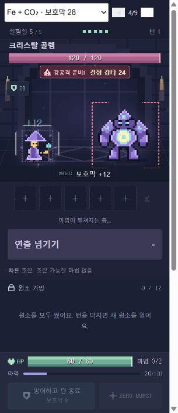
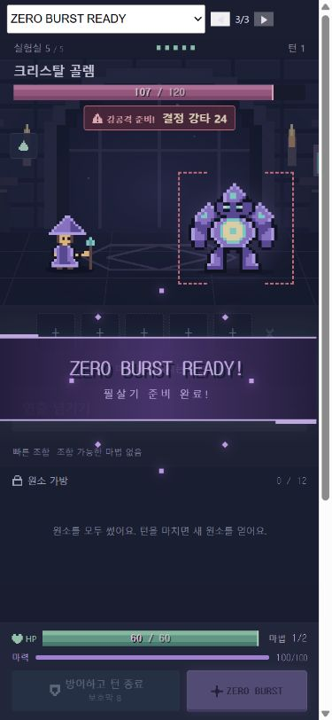
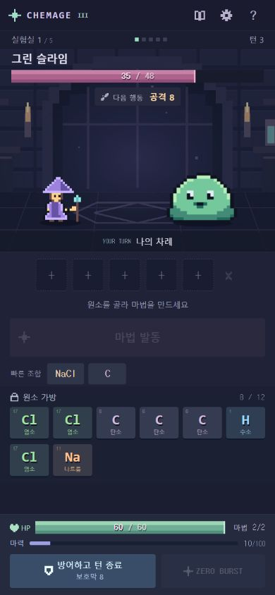

# PHASE 3.1 + 보호막 최종 규칙 검증

공개 Pages는 PHASE 3으로 유지. 이 문서는 로컬 PHASE 3.1 개발본의 검증 기록입니다.

## 구현

- 실제 턴 경계에서 YOUR TURN / ENEMY TURN, 첫 마법 뒤 중복 배너 없음. 배너 중 전투 입력 잠금.
- 방어하고 턴 종료 버튼 통합, 강화된 실제 보호막 표시, 중복 입력 거절.
- ZERO BURST READY는 충전당 한 번, 순차 알림, 보라색 완충 표시. 피해 30과 턴 소모 규칙 유지.
- 발견한 조합 최대 3개 추천, 자동 선택, 조합 불가 안내, 공격 가능 여부에 따른 버튼 강조.
- 실제 엔진으로 예측한 HP 피해와 적 보호막 흡수 분리. 방어 마법은 증가량과 총합 표시.
- 위험한 예고만 강조하며 적 패턴과 수치 유지. 처치 픽셀 연출 및 전용 효과음.
- 1.0/1.5배속, 배너 간소화, 시스템/게임 움직임 줄이기 지원.
- 모든 보호막 합산. CO₂는 첫 직접 화염에 최대 5 감소, C는 모든 직접 타격 종료 후 한 번 3 반사.
- 다중 타격 사이 잔여 보호막 유지. 적 행동 종료·비공격 행동·전투 종료에 임시 방어 효과 제거. 동시 사망은 플레이어 패배 우선.
- 보호막 총합 한 개, 증가량, 타격별 잔량/HP 피해, BLOCK 표시, 행동 종료 한 번의 소멸 연출.
- 신규 원소·마법·적·스테이지 없음. 다중 타격은 엔진과 검증용 시나리오만 지원하며 실제 기존 적 패턴은 그대로입니다.

## 자동 검사

- `npm.cmd test`: 8개 파일, 128개 테스트 통과.
- `npm.cmd run build`: TypeScript 검사 및 Vite 프로덕션 빌드 성공.
- 4전략 × 200시드 기존 엔진 시뮬레이션 포함. 결과는 `phase3-1-balance.json`; 사람의 승률이나 최적 전략 증명으로 해석하지 않습니다.
- 보호막 예시 A/B/C/D, 동종/이종 합산, 강화 방어, 중복 입력, 화염 감소/반사 횟수와 순서, 패배 우선, 비공격 만료 검증.
- 실제 마법 10종의 피해 예측을 버프·디버프·강화·방어력·방어막·낮은 HP 조합과 비교.
- 배너/준비 알림 순서, 재시작/승리/패배/보상/다음 전투, 1.0/1.5배속 및 재생 중 속도 변경 검증.

## 실제 브라우저

- 실제 게임: 전투 시작 YOUR TURN과 입력 잠금, H₂O 예상 피해 13과 실제 HP 48 → 35, 첫 마법 후 턴 1 유지 및 마법 1/2.
- 통합 방어 후 HP 60 유지, 보호막 제거, 턴 2. 1.5배속·간소화 적용 후 ENEMY TURN → 턴 3 및 입력 해제 확인.
- 개발용 `/qa/`는 실제 엔진·순서 관리·전투 화면을 사용하며 일시 정지해 연출을 검사합니다. 배포 빌드에는 포함되지 않습니다.
- 320×740, 390×844, 430×932: 가로 넘침 없음, 하단 행동 버튼이 화면 안에 배치됨.
- 고정 시나리오: Fe + CO₂ 총 28과 +12, 위험 예고 24, YOUR/ENEMY TURN, ZERO READY, 보스 처치 표시.
- 연속 타격 시나리오: 보호막 24 → 첫 타격 10 후 14/BLOCK → 두 번째 타격 20 후 보호막 0/HP 54(−6).
- 실제 게임 및 검증 페이지 콘솔 경고/오류 없음.

## 확인 범위

Windows 데스크톱 브라우저의 모바일 크기로 확인했습니다. 실제 iOS/Android 기기에서 터치·오디오 청취 검증은 수행하지 않았습니다. 공개 사이트는 PHASE 3이며, 이번 로컬 변경은 추가 배포하지 않았습니다.

