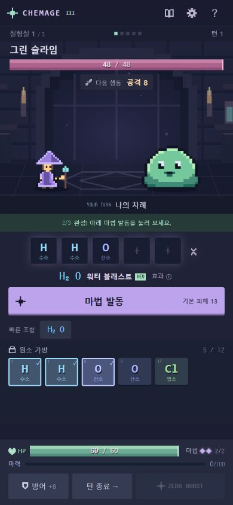

# PHASE 3 공개 배포

- URL: https://indong2026.github.io/CHEMAGE/
- 저장소: https://github.com/indong2026/CHEMAGE
- 배포 원본: `releases/phase3` (PHASE 3.1 수정본과 분리)
- 배포 커밋: `8bf67e7e5bf350e7fb0fe122a9b985dce400af11`
- 성공 Actions: https://github.com/indong2026/CHEMAGE/actions/runs/40085972192
- 원본 버전 자동 테스트 79개, TypeScript 검사, Vite 빌드, Pages 배포 성공.
- 공개 페이지 실제 브라우저에서 새 게임과 H₂O 시전을 검증. 적 HP 48 → 35, 마력 10, 남은 마법 1회.
- 공개 번들: `index-JdtNFJaO.js`, `index-Bm2QZ7Q6.css` — 보관한 PHASE 3 빌드와 일치.
- 최초 Linux CI 오류는 lockfile의 Linux용 선택적 빌드 의존성 누락이 원인이었고, 기존 버전과 일치하는 esbuild/rollup 항목으로 수정.
- `releases/prepare-phase3.mjs`는 당시 소스를 복구한 일회성 보관 스크립트이며 현재 개발본에서 재실행하지 않음.

PHASE 3.1 + 13번 규칙은 로컬 개발본이며 이 배포에는 포함되지 않습니다.
