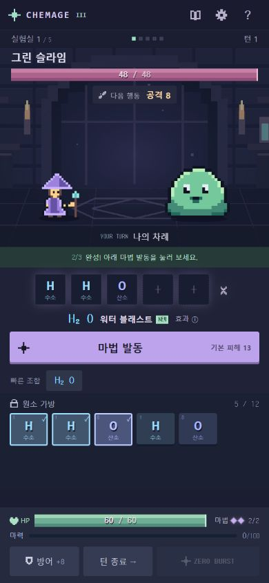
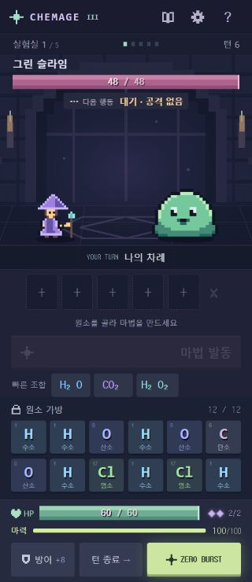

# CHEMAGE PHASE III 검증

검증일: 2026-10-24. Windows, Node 22.23.2. 기존 React + TypeScript + Vite 프로젝트에서 구현했습니다. 공개 배포는 수행하지 않았습니다.

## 구현 범위

- 예약/잠금/3연쇄/기본 공격/원소 방출/정제 제거. 최대 2회 즉시 시전으로 변경.
- 전투 시작 5개, 턴 시작 기본 3개, 기본 가방 12개. 기존 원소 보존, 신규 초과분만 마력 전환.
- 시전 +10, 초과 원소 +15, 마력 상한 100. 수동 ZERO BURST는 마력 100 소비, 피해 30, 방어력 무시, 적 보호막 적용, 턴 종료.
- 화학식 완성 시 발견 저장. 발견했고 만들 수 있는 마법 최대 3개 추천, 선택과 시전 분리.
- 5슬롯 조합, 큰 발동 버튼, 단순한 HP/마력/행동 하단 패널, 상태 상세 보기, 3단계 첫 전투 안내.
- 기존 10개 마법/5개 적/보상/도감/승패 유지. 투사체, 명중, 적 공격, 사망, 연계 표시, 효과음, 2배속, 연출 넘기기, 움직임 줄이기 연결.

## 자동 검증

`npm.cmd test`: **5개 파일 / 79개 테스트 통과**, 33.38초.

화학식 순서 독립 판정, 중복 ID 거절, 실제 선택 원소만 소비, 첫/둘째 시전 경계, 방어·종료, 연계, 보호막·반사 유지, 지속 상태 감소, 신규 초과분 변환, 마력 상한, ZERO 발동/처치/방어력, 타격별 HP 프레임, 승패·보상·재시작·도감 저장, 중복 클릭, 튜토리얼, 설정을 검증합니다.

`npm.cmd run build`: **TypeScript 검사 및 Vite 빌드 통과**. 52개 모듈. JS 275.65 kB / gzip 87.74 kB, CSS 47.46 kB / gzip 12.07 kB. `qa/`는 빌드에 포함하지 않습니다.

## 실제 엔진 시뮬레이션

각 전략은 시드 1~200, 기본 HP와 실제 원소 확률 및 보상을 사용합니다. 행동마다 남은 한 번의 시전을 평가하는 휴리스틱이며 모든 화학식을 알고 있는 정책입니다. 시각 검사용 고정 원소/체력을 사용하지 않습니다. 이 수치는 사람의 실제 승률이나 재미를 보장하지 않습니다.

| 전략 | 5전투 승리 | 패배 | 진행 정체 |
| --- | ---: | ---: | ---: |
| 두 번 시전 + 방어/연계 | 184/200 (92%) | 16 | 0 |
| 한 턴 최대 한 마법 | 160/200 (80%) | 40 | 0 |
| 방어 마법/방어 행동 제외 | 1/200 (0.5%) | 199 | 0 |
| 방어 + 넘침 + ZERO만 | 1/200 (0.5%) | 199 | 0 |

두 번 시전 정책은 총 1,100회 연계, 629회 ZERO를 사용했습니다. 전투별 평균 턴은 4.69 / 3.60 / 4.51 / 5.28 / 5.61입니다. 첫 턴 처치 0회, 패배 16회는 모두 보스에서 발생했습니다. 방어와 연계를 사용하는 이유가 있고 방어만 반복하는 정책은 전체 모험에서 우세하지 않았습니다. 방어 없는 전략의 승률은 매우 낮으므로 실제 초보자 난이도는 추가 플레이 피드백으로 판단해야 합니다.

원시 수치: [phase3-balance.json](phase3-balance.json).

## 브라우저 확인

인앱 브라우저에서 실제 게임 버튼을 조작했습니다.

- 390×844: H/H/O 선택, 발견 표시, 첫 H₂O 시전 후 적 HP 48→35, 내 HP 60 유지, 마력 10, 남은 시전 1 확인.
- 수동 턴 종료 후 적 공격으로 내 HP 60→52, 다음 턴 원소 3개 지급, 튜토리얼 종료 확인.
- 다음 턴 H₂O와 FeO를 연속 사용한 뒤 적 HP 35→22→8, 자동 적 행동, 턴 3, 마력 30 확인.
- 320×740: 페이지 폭/높이 320×740, 가로 넘침 없음, 하단 버튼까지 화면 내부. 가방 12개를 2줄로 표시.
- 별도 새 모험에서 방어를 반복하여 5→8→11→12개, 마력 0→30→75→100, 기존 가방 원소 유지, ZERO 버튼 활성화 확인. 버리기 팝업 없음.
- CH₄ 첫 시전으로 슬라임 48→28, 남은 시전 1. 이어 ZERO로 처치하고 추가 적 행동 없이 승리 보상 화면 진입, HP 60 확인.
- 해당 최종 플레이 탭의 콘솔 경고/오류 0건.

## 확인 범위와 한계

브라우저의 모바일 크기로 검사했으며 실제 iOS/Android 기기의 터치 감각, 오디오 출력, WebView 동작까지 검증한 것은 아닙니다. 5전투 전체의 규칙 검증은 자동 테스트/시뮬레이션으로 수행했고 수동 브라우저 플레이는 첫 전투를 중심으로 진행했습니다. 새로고침하면 모험은 초기화되며 도감 발견만 남습니다. 외부 공개 URL은 아직 없습니다.
